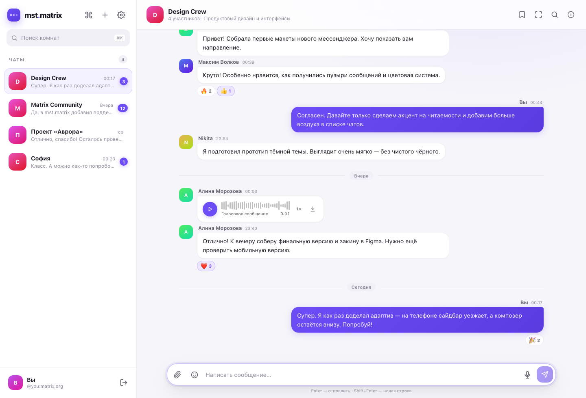
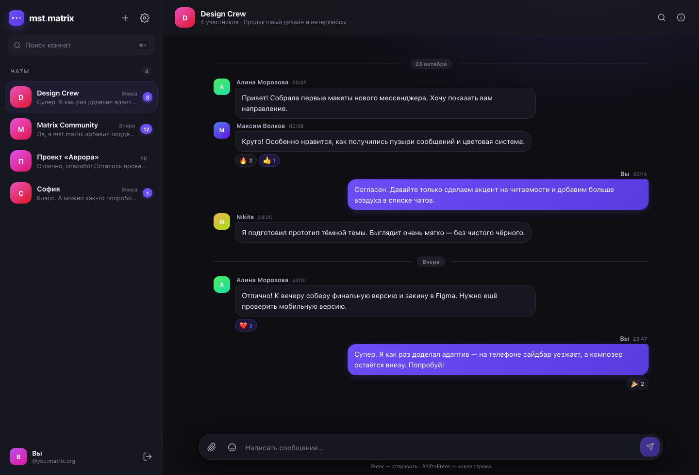

# mst.matrix

Современный веб-клиент **Matrix** с Material-подобным интерфейсом, светлой и тёмной темами, гибкой акцентной палитрой и полноценной работой с комнатами, сообщениями и медиа прямо в браузере.



## Основные возможности

- **Вход в Matrix** по homeserver URL, Matrix ID и паролю, а также **через SSO** (`m.login.sso`), с сохранением сессии и автоматическим восстановлением.
- **Список комнат** с аватарами, последним сообщением, временем, непрочитанными и черновиками.
- **Живые сообщения**: текст, Markdown-разметка, ссылки, изображения, аудио, видео и файлы.
- **Отправка**: текст, вложения, ответы на сообщения, эмодзи и **голосовые сообщения**.
- **Реакции** на сообщения с агрегированным количеством.
- **Редактирование и удаление** собственных сообщений.
- **Ответы**: цитата исходного сообщения и переход к нему по клику.
- **Индикатор набора текста** и автоматические read-receipts.
- **Поиск** по комнатам и по сообщениям в выбранной комнате.
- **Создание комнат** (публичных и приватных), **вход по адресу/ID**, **директория публичных комнат** и **личные переписки**.
- **Приглашения**: принятие и отклонение прямо из списка чатов.
- **Уведомления по комнатам**: все / только упоминания / выключено (mute).
- **Глобальный поиск**: сообщения, комнаты и люди (Ctrl/Cmd+F).
- **Информация о комнате** со списком участников, приглашением пользователей и выходом.
- **Настройки комнаты**: имя, тема, аватар и алиасы.
- **Профили участников** с быстрым переходом к личной переписке; загрузка собственного аватара.
- **Звонки 1:1**: аудио и видео через Matrix VoIP/WebRTC, входящие звонки, mute микрофона и камеры.
- **Опросы**: создание, голосование, результаты в реальном времени, завершение.
- **Ветки (threads)**: просмотр ветки целиком и ответы прямо в ней.
- **Пространства (Spaces)**: список и иерархия с быстрым входом в комнаты.
- **PWA**: устанавливается на устройство, работает офлайн благодаря service worker.
- **Профиль**: отображаемое имя, Matrix ID, статистика, сведения об устройстве.
- **Настройки**: светлая/тёмная/системная тема, 5 акцентных цветов, звук и браузерные уведомления.
- **Бесконечная прокрутка** истории сообщений.
- **Адаптивный интерфейс**: отдельная мобильная раскладка с выдвижным сайдбаром и действиями по тапу.
- **Демо-режим** без сервера: откройте [`/#demo`](https://kirilldual0987.github.io/mst.matrix/#demo) и посмотрите интерфейс.



## Фишки, которых обычно нет

### Командная палитра — `⌘K` / `Ctrl+K`
Переключение комнат, создание чата, темы, настройки, профиль, фокус-режим и сводка непрочитанного — всё в одном поиске. Навигация стрелками, запуск по `Enter`.

### Режим фокуса — `F`
Скрывает сайдбар и шапку чата, оставляя только переписку и композер. Выход по `Esc` или кнопке в углу.

### Сводка непрочитанного
Локальный «recap»: активные комнаты, количество непрочитанных и последнее сообщение. Без отправки данных куда-либо.

### Сохранённые сообщения
Локальное избранное с закладками на сообщения, переходом к оригиналу и удалением. Хранится в браузере.

### Голосовые сообщения
Запись с микрофона прямо в браузере, таймер, отмена, отправка. Голосовые можно слушать в кастомном плеере.

### Кастомный аудиоплеер
Волновая дорожка, перемотка кликом, скорость `1× / 1.5× / 2×`, длительность и скачивание. Работает и для обычных, и для зашифрованных вложений.

### E2EE-вложения
Клиент не только расшифровывает зашифрованные изображения, аудио, видео и файлы, но и **шифрует свои вложения** в E2EE-комнатах по спецификации Matrix (`v2`, AES-CTR + SHA-256), прежде чем загрузить их на сервер.

### Черновики по комнатам
Незаконченный текст сохраняется отдельно для каждого чата и показывается в списке комнат.

### Умные детали
- Непрочитанные в заголовке вкладки.
- Индикатор печати по событиям участников.
- Поддержка веток: ответы из ветки не пропадают.
- Авторизованные медиа и fallback на обычные URL.
- Локальные уведомления и звук.
- Плашка о переезде на новый домен: появляется при каждом заходе, автоматически скрывается через 10 секунд или закрывается вручную.

## Технологии

- [matrix-js-sdk](https://github.com/matrix-org/matrix-js-sdk) — Matrix Client-Server API, синхронизация и Rust E2EE.
- [matrix-encrypt-attachment](https://github.com/matrix-org/matrix-encrypt-attachment) — шифрование вложений по спецификации Matrix.
- [Vite](https://vitejs.dev/) — сборка статического бандла.
- Чистый JavaScript и CSS без UI-фреймворка: интерфейс собран вручную, поэтому загружается быстро и не зависит от сторонних компонентных библиотек.
- Иконки — собственный inline SVG-набор.

## Локальный запуск

```bash
npm install
npm run dev
```

Vite откроет адрес вида `http://localhost:5173`.

Для проверки production-сборки:

```bash
npm run build
npm run preview
```

## Сборка и GitHub Pages

Production-сборка складывается в каталог `docs/`:

```bash
npm run build
```

В настройках репозитория GitHub Pages должен быть выбран источник:

- **Branch:** `main`
- **Folder:** `/docs`

После пуша собранной версии клиент доступен по адресу:

**https://kirilldual0987.github.io/mst.matrix/**

## Структура

```
mst.matrix/
├─ index.html          # разметка приложения
├─ src/
│  ├─ main.js          # логика клиента, Matrix SDK, UI-состояния
│  ├─ style.css        # дизайн-система, темы, адаптивность
│  └─ icons.js         # inline SVG-иконки
├─ public/
│  ├─ .nojekyll        # отключает Jekyll на GitHub Pages
│  └─ preview-*.png    # скриншоты для README
├─ docs/               # готовый production-бандл (результат npm run build)
├─ package.json
└─ vite.config.js
```

## E2EE: если старые сообщения не расшифровываются

Новое устройство не получает ключи автоматически. Чтобы прочитать историю:

1. Откройте **Настройки → Безопасность**.
2. Посмотрите строку **E2EE** — там будет статус и точная ошибка, если инициализация не удалась.
3. В блоке **Резервная копия ключей** введите **recovery key** (ключ безопасности из Element) и нажмите «Восстановить ключи», либо «Ключ из Secret Storage».
4. Если резервной копии нет, проверьте это устройство с другого устройства через **SAS-эмодзи**: «Проверить другое устройство» / профиль собеседника.
5. После восстановления ключей нажмите «Расшифровать заново» в настройках или откройте комнату.

## Безопасность и ограничения

- Это полностью клиентское приложение: сообщения идут напрямую между браузером и вашим homeserver, промежуточного сервера нет.
- Access token сохраняется в `localStorage` (или `sessionStorage`, если снять «Запомнить меня»). Используйте клиент только на доверенном устройстве.
- Для E2EE нужен браузер с поддержкой WebAssembly и IndexedDB; ключи хранятся локально. Верификация устройств реализована (SAS-эмодзи и доверие); настройка резервного копирования ключей и кросс-подписи выполняется сервером/другими клиентами.
- Групповые звонки и push-уведомления при закрытой вкладке не входят в текущую версию. Для звонков 1:1 нужен WebRTC и TURN-сервер, который выдаёт ваш homeserver; без TURN звонки могут не соединяться через NAT.

## Лицензия

Код клиента распространяется свободно. Matrix и matrix-js-sdk принадлежат их правообладателям.
